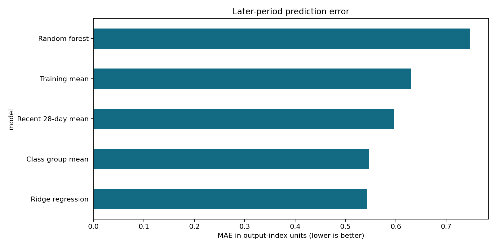

# Connected Fitness Performance Analytics
**GSBA 594–42H: AI & Machine Learning in Business Analytics**

## Business problem
Can workout history and scheduled-class characteristics support useful pre-ride performance expectations for a connected fitness service? The decision is whether a prediction prototype provides enough value beyond simple historical summaries to justify further testing. Stakeholders include members, coaches and platform product teams.

This case study uses a de-identified longitudinal workout dataset. The release does not identify its data owner or distribute the original export. It is not an evaluation of Peloton's proprietary algorithms.

## Final key results
- **Ridge regression has the lowest error in the later evaluation period:** MAE **0.543 output-index units**, compared with **0.747** for random forest and **0.630** for a fixed training mean.
- **Regression lowers later-period MAE by 13.8% relative to the training-mean baseline and by 27.3% relative to random forest.** A more complex method did not improve this comparison.
- **The recent 28-day average wins the specified development selection rule:** mean validation MAE **0.587**, versus **1.364** for regression. Its later-period MAE is **0.596**. This remains the selected method under that rule.
- **Performance varies across periods.** Restricting the development window changes the comparison. The regression advantage in the later period does not establish universal superiority.
- **The modeling sample contains 420 scheduled-class rides:** 331 development rides and 89 later evaluation rides. Same-day observations stay together.
- **The later comparison is exploratory.** Earlier work already exposed this period. New future observations are needed for prospective confirmation.
- **Recommendation:** retain transparent benchmarks and validate useful feedback prospectively before deployment. The study does not establish improved health, retention or revenue.

## Variables used in the model
**Target:** `output_index`, a masked linear index of average cycling power. Original target values and conversion constants are excluded. MAE/RMSE are therefore reported in index units, not original power units.

The regression and random forest use exactly these ten predictors:

| Model variable | Meaning | Type | Handling |
|---|---|---|---|
| planned_duration_index | Nominal scheduled class duration | Numeric | Positive affine index; available before the ride |
| start_time_index | Planned start hour, approximated by recorded start hour | Numeric | Positive affine index |
| elapsed_time_index | Calendar time since the beginning of the observation period | Numeric | Positive affine index |
| exercise_7d_index | Sum of logged exercise minutes in the preceding 7 calendar days | Numeric | Excludes the entire current day; indexed |
| exercise_28d_index | Sum of logged exercise minutes in the preceding 28 calendar days | Numeric | Excludes the entire current day; indexed |
| exercise_days_7d_index | Number of prior 7 days with logged exercise | Numeric | Excludes current day; indexed |
| recent_output_index | Mean observed main-ride output in the preceding 28 days | Numeric | Same index scale as target; missing when no recent rides |
| class_type | Scheduled class category | Categorical | One-hot encoded inside training folds |
| instructor_code | Scheduled instructor | Categorical | Stable pseudonymous code; one-hot encoded |
| weekday_code | Scheduled day of week | Categorical | Stable code without original weekday labels; one-hot encoded |

`ride_id` identifies rows and `day_index` preserves relative chronology for splitting. Neither is an additional predictor. Sensitivity-group flags define robustness subsets and never enter the models. Current-ride output totals, cadence, resistance, heart rate, calories and distance are excluded because they would be unavailable before the ride or mathematically leak the target.

## Model comparison
All errors below use the same output-index scale. Lower MAE is better. Development MAE is the unweighted average across three expanding time splits.

| Candidate | Development MAE | Later MAE | Later R² |
|---|---:|---:|---:|
| Training mean | 0.973 | 0.630 | -0.171 |
| Class group mean | 0.886 | 0.547 | 0.105 |
| Recent 28-day mean | 0.587 | 0.596 | -0.071 |
| Ridge regression | 1.364 | 0.543 | 0.171 |
| Random forest | 1.067 | 0.747 | -0.530 |


**Reading the result correctly:** regression leads the later-period comparison; the recent average leads development selection. These are separate findings. Selecting regression after inspecting the later period would change the stated selection rule retrospectively.

## Scaling and data masking
- Numeric predictors were already standardized with `StandardScaler` within each training fold. Training-fitted median imputation precedes scaling. Categorical predictors use training-fitted one-hot encoding.
- This release additionally provides indexed numeric data, an indexed target, relative days/weeks and coded instructors/weekdays. It omits source filenames, exact timestamps, class titles, raw measurements, identifying narrative and inverse-conversion keys.
- A fixed positive affine transformation preserves ordering. Linear predictions can be expressed on the transformed target scale; R² and percentage error improvements retain their meaning. MAE/RMSE change units when the target is rescaled.
- Scaling is not universally neutral for every model or regularization setup. The existing within-fold standardization is retained, and the transformation was checked. Tiny random-forest differences arise from floating-point/tied split behavior, while the substantive ranking stays the same. See [MASKING_CHECK.md](docs/MASKING_CHECK.md).
- Masking reduces exposure; it is not encryption or a guarantee of anonymity. Time patterns and relationships remain visible. This release should not be combined with inverse keys or the original export in a published repository.

## Run the project
Python 3.11+:
```bash
python -m pip install -r requirements.txt
python analyze_peloton.py
python -m unittest discover -s tests -v
jupyter lab Peloton_Analysis.ipynb
```
The notebook includes executed Python outputs. The supplied runner captures sequential code execution without a Jupyter kernel. Re-running in Jupyter uses the same Python functions.

## Repository guide
| File | Purpose |
|---|---|
| [data/model_features.csv](data/model_features.csv) | Masked modeling data and target |
| [data/activity_trends.csv](data/activity_trends.csv) | Indexed descriptive activity series |
| [data/sensitivity_groups.csv](data/sensitivity_groups.csv) | Robustness subset flags, not predictors |
| [analyze_peloton.py](analyze_peloton.py) | Reproducible modeling and visualizations |
| [Peloton_Analysis.ipynb](Peloton_Analysis.ipynb) | Executed walkthrough |
| [results/model_scores.csv](results/model_scores.csv) | Later-period results |
| [docs/DATA_DICTIONARY.md](docs/DATA_DICTIONARY.md) | Complete release variable definitions |
| [docs/METHODS.md](docs/METHODS.md) | Collection, preparation, timing and limitations |
| [docs/PROPOSAL.md](docs/PROPOSAL.md) | Revised neutral proposal |
| [docs/PROJECT_REPORT.md](docs/PROJECT_REPORT.md) | Findings and implications |
| [docs/SPEAKER_GUIDE.md](docs/SPEAKER_GUIDE.md) | Updated slide talking points |
| [docs/FEEDBACK_CHANGES.md](docs/FEEDBACK_CHANGES.md) | Professor feedback mapping |



## Submission and version history
Use this revised release in place of the earlier package. The [revised presentation](https://chatgpt.com/space/page_6b4318629d988191b8a8d119491a9d8c) can be exported as PPTX for Canvas. Add the actual GitHub URL before submission. No repository or Canvas changes were made automatically.
If original data were committed to GitHub, replacing the current files does not remove earlier commits, copies or cached downloads. Review existing repository history and access before treating a published version as protected. Student authorship is separate from dataset ownership.

## AI assistance
AI assisted with code and drafting. The presenter should review and run the project, explain the methods and follow the course's AI-use policy.

Public aggregate company context is retained in data/industry_context.csv as a separate contextual source. It is not used to predict individual rides.
